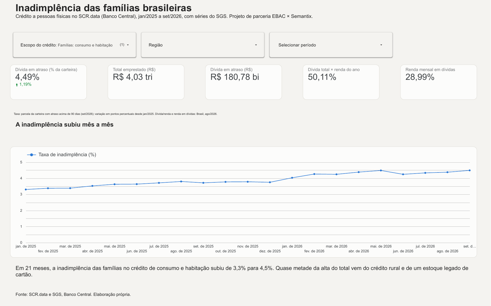
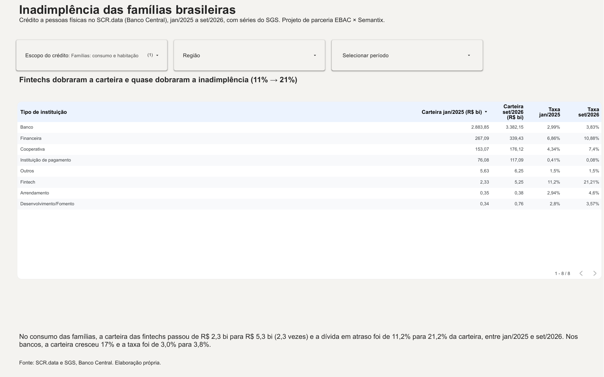

# Looker Studio Dashboards

[](https://lookerstudio.google.com/)
[](LICENSE)

Reports built in Looker Studio during the **Data Analyst program at EBAC**, including the EBAC × Semantix partnership project.

> 🇧🇷 Versão em português: [README.md](README.md)

Looker Studio reports live in the cloud: there is no file to download. What this repository holds is the **live link**, captures of each page, and documentation of how each dashboard was built.

---

## Brazilian household loan defaults

**[▶ Open the report](https://datastudio.google.com/reporting/863e566d-9912-46a7-b902-ac9d8ac9dbeb)** · [PDF](https://github.com/gstvhortencio/inadimplencia-familias-br/blob/main/docs/looker_studio_relatorio.pdf) · [Project repository](https://github.com/gstvhortencio/inadimplencia-familias-br)

> Looker Studio requires a Google account login. Without one, use the PDF. The report is in Portuguese.



An **EBAC × Semantix** partnership project: six pages on defaults in consumer credit, using SCR.data (Central Bank of Brazil) from Jan/2025 to Sep/2026 plus SGS series. Credit scope, region and period filters on every page.

| Page | Finding |
|---|---|
| Overview | In consumer and housing credit, the default rate rose from 3.3% to 4.5% in 21 months |
| Products | Revolving card credit (21%), overdraft (15%) and issuer instalment card credit (14%) concentrate the risk |
| States | The North leads; Paraíba has the second-lowest rate in the country (3.6%) |
| Borrower profile | No declared income: 15.1% past due, against 2.5% to 7.3% in income brackets |
| Growth × risk | Fintechs more than doubled their book, and their rate went from 11.2% to 21.2% |
| Recommendations | Seven actions for lenders, government and households |

The key analytical decision is the scope filter: rural credit and a legacy card balance account for almost half the rise in total individual credit. Mixed with household consumption they distort the diagnosis, so they are excluded by default.

<details>
<summary>See the other pages</summary>





</details>

📄 **[Full documentation and open points](docs/inadimplencia-familias.md)** *(in Portuguese)*

---

## Gatito e-commerce

**[▶ Open the report](https://datastudio.google.com/s/t32z_HwoxpA)**


An e-commerce dashboard covering acquisition and behaviour, fed by the Google Analytics connector. Two pages, a period selector and automatic comparison against the previous period.

### Page 1 — Overview

| Indicator | Value | vs. previous |
|---|---:|---:|
| Total revenue | $211,461.94 | ▲ 20.3% |
| Transactions | 974 | ▼ 13.7% |
| Average order value | $217.11 | ▲ 39.3% |
| Conversion rate | 0.85% | ▼ 20.7% |

The combination is the interesting part: **revenue up 20% while transactions fall 14%**. All the growth came from average order value (+39%), not volume — and conversion fell alongside. Fewer people buying, each spending more.

Two competing explanations the available data cannot separate: a shift in product mix, or a shift in audience. Telling them apart would need revenue by category and by acquisition channel, neither of which is in the report.

### Page 2 — User behaviour


| Indicator | Value | vs. previous |
|---|---:|---:|
| Sessions | 114,541 | ▲ 8.8% |
| Engaged sessions | 42,507 | ▲ 0.9% |
| Active users | 88,869 | ▲ 7.9% |
| Engagement rate | 37.11% | ▼ 7.3% |

Sessions grow 8.8%, but engaged sessions barely move (+0.9%) — hence the drop in engagement. More traffic, of lower quality.

---

## Figure consistency

The derived indicators reconcile against the base metrics:

```
Average order value = 211,461.94 / 974     = $217.11   ✓
Conversion rate     = 974 / 114,541        = 0.85%     ✓
Engagement rate     = 42,507 / 114,541     = 37.11%    ✓
Sessions per user   = 114,541 / 88,869     = 1.29      ✓
```

The user card uses `Active users`, not `7-day active users` — the latter is a rolling window that Looker Studio sums across the period, yielding a figure larger than total sessions, and whose aggregation the connector will not let you change.

📄 **[Full documentation and open points](docs/ecommerce-gatito.md)** *(in Portuguese)*

---

## Structure

```
looker-studio-dashboards/
├── README.md / README.en.md
├── LICENSE
├── inadimplencia-familias/
│   └── img/                       6 captures, one per page
├── ecommerce-gatito/
│   └── img/
│       ├── 01-visao-geral.png
│       └── 02-comportamento-usuario.png
└── docs/
    ├── inadimplencia-familias.md
    └── ecommerce-gatito.md
```

Further Looker Studio reports get their own subfolder as the course progresses.

## Author

**Gustavo Hortêncio da Silva** — Economist (UFPB), training as a Data Analyst at EBAC.

[](https://github.com/gstvhortencio)

📊 Power BI dashboards: [powerbi-dashboards](https://github.com/gstvhortencio/powerbi-dashboards)
📚 Course notes: [ebac-analise-de-dados](https://github.com/gstvhortencio/ebac-analise-de-dados)

## Licence

Released under the MIT licence. See [`LICENSE`](LICENSE).
