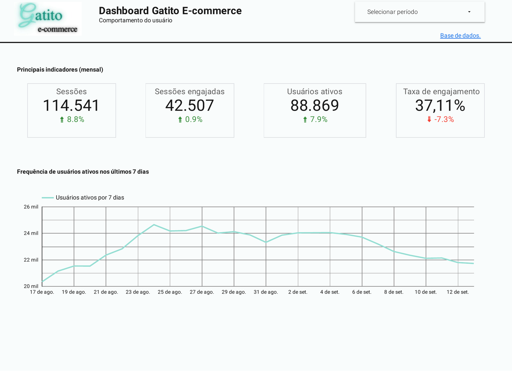

# Dashboards em Looker Studio

[](https://lookerstudio.google.com/)
[](LICENSE)

Relatórios construídos no Looker Studio durante o curso de **Analista de Dados da EBAC**.

> 🇬🇧 English version: [README.en.md](README.en.md)

Relatórios do Looker Studio vivem na nuvem: não há arquivo a baixar. O que este repositório guarda é o **link vivo**, as capturas de cada página e a documentação de como cada dashboard foi montado.

---

## E-commerce Gatito

**[▶ Abrir o relatório](https://datastudio.google.com/s/t32z_HwoxpA)**


Dashboard de e-commerce com métricas de aquisição e comportamento, alimentado pelo conector do Google Analytics. Duas páginas, seletor de período e comparação automática contra o período anterior.

### Página 1 — Visão Geral

| Indicador | Valor | vs. período anterior |
|---|---:|---:|
| Receita total | $211.461,94 | ▲ 20,3% |
| Transações | 974 | ▼ 13,7% |
| Ticket médio | $217,11 | ▲ 39,3% |
| Taxa de conversão | 0,85% | ▼ 20,7% |

A combinação é a parte interessante: **receita sobe 20% enquanto transações caem 14%**. O crescimento veio inteiramente de ticket médio (+39%), não de volume — e a conversão caiu junto. Menos gente comprando, cada uma gastando mais.

Duas explicações concorrentes que os dados presentes não separam: mudança de mix de produto ou mudança de público. Distinguir exigiria receita por categoria e por canal de aquisição, nenhuma das duas no relatório.

### Página 2 — Comportamento do usuário



| Indicador | Valor | vs. período anterior |
|---|---:|---:|
| Sessões | 114.541 | ▲ 8,8% |
| Sessões engajadas | 42.507 | ▲ 0,9% |
| Usuários ativos | 88.869 | ▲ 7,9% |
| Taxa de engajamento | 37,11% | ▼ 7,3% |

Sessões crescem 8,8%, mas sessões engajadas quase não se movem (+0,9%) — daí a queda no engajamento. Mais tráfego, de qualidade menor.

---

## Consistência dos números

Os indicadores derivados fecham com as métricas base:

```
Ticket médio        = 211.461,94 / 974      = $217,11   ✓
Taxa de conversão   = 974 / 114.541         = 0,85%     ✓
Taxa de engajamento = 42.507 / 114.541      = 37,11%    ✓
Sessões por usuário = 114.541 / 88.869      = 1,29      ✓
```

O cartão de usuários usa `Usuários ativos` e não `Usuários ativos por 7 dias` — essa segunda é uma janela móvel que o Looker Studio soma ao longo do período, produzindo um número maior que o total de sessões, e cuja agregação o conector não deixa alterar.

📄 **[Documentação completa e pontos a revisar](docs/ecommerce-gatito.md)**

---

## Estrutura

```
looker-studio-dashboards/
├── README.md / README.en.md
├── LICENSE
├── ecommerce-gatito/
│   └── img/
│       ├── 01-visao-geral.png
│       └── 02-comportamento-usuario.png
└── docs/
    └── ecommerce-gatito.md
```

Novos relatórios do Looker Studio entram como subpastas próprias conforme o curso avança.

## Autor

**Gustavo Hortêncio da Silva** — Economista (UFPB), em formação como Analista de Dados pela EBAC.

[](https://github.com/gstvhortencio)

📊 Dashboard em Power BI: [powerbi-dashboard-vendas](https://github.com/gstvhortencio/powerbi-dashboard-vendas)
📚 Anotações do curso: [ebac-analise-de-dados](https://github.com/gstvhortencio/ebac-analise-de-dados)

## Licença

Distribuído sob a licença MIT. Veja [`LICENSE`](LICENSE).
